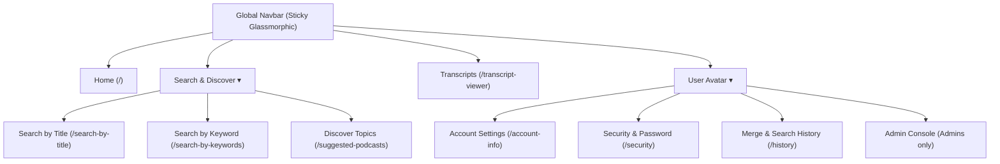

# VidFusion — Comprehensive UI/UX Audit & Modernization Report

> **Prepared By:** Senior UI/UX & Product Design Specialist  
> **Project:** VidFusion (AI Video Summarization & Fusion Platform)  
> **Audit Date:** October 2026  
> **Scope:** Full Frontend Codebase (`src/**`), Layouts, Component Interactions, Navigation & Aesthetics  
> **Status:** Read-Only Audit & Concrete Recommendations (Zero code changes applied)

---

## 1. Executive Summary & Design Maturity Scorecard

VidFusion has solid underlying backend capabilities (hybrid transcript recovery, FAISS semantic fusion, Whisper STT, ARQ merge queues, and interactive RAG chat). However, the **current frontend UI/UX experiences significant usability friction, inconsistent design paradigms, navigation dead-ends, and outdated aesthetic patterns** that prevent it from feeling like a top-tier modern AI SaaS application (e.g., Linear, Supabase, Perplexity, or Descript).

### Overall Design Scorecard

| Area | Current Rating | Modern Benchmark | Key Deficiencies |
| :--- | :---: | :---: | :--- |
| **Visual Aesthetics & Polish** | **5.5 / 10** | **9.5 / 10** | Inconsistent dark mode tones (`#000212` vs `#0F172A` vs `#111827`), flat borders, raw browser alerts. |
| **Information Architecture (IA)** | **5.0 / 10** | **9.0 / 10** | Key features like *Search by Keywords* are missing from Navbar and Footer; orphaned `MergePreviewPage`. |
| **Component Consistency** | **4.5 / 10** | **9.5 / 10** | Three clashing styling paradigms: Inline JS style objects, legacy CSS files, and Tailwind utility classes. |
| **Interactive UX & Feedback** | **5.5 / 10** | **9.0 / 10** | Confusing button roles (thumbnail play icon toggles selection instead of playing), lack of skeleton loaders. |
| **Mobile Responsiveness** | **5.0 / 10** | **9.0 / 10** | Admin/User tables clip horizontally; floating FAB bot overlaps MultiSelectBar controls on narrow screens. |
| **Accessibility (WCAG 2.1 AA)** | **5.0 / 10** | **9.0 / 10** | Very low contrast secondary text (`rgba(255,255,255,0.25)`), missing `aria-label`s on icon buttons. |

---

## 2. Systemic Architectural UI/UX Flaws

### 2.1. The Root Re-Render Bug (`mousemove` in `App.js`)
* **File Reference:** `src/App.js` (Lines 71–79, 84–89)
* **The Bug:** `App.js` binds an unthrottled `mousemove` event listener directly to React state:
  ```javascript
  const [mousePos, setMousePos] = useState({ x: 0, y: 0 });
  useEffect(() => {
    const handleMouse = (e) => setMousePos({ x: e.clientX, y: e.clientY });
    window.addEventListener('mousemove', handleMouse);
    return () => window.removeEventListener('mousemove', handleMouse);
  }, []);
  ```
* **UX Impact:** Every single pixel the user moves their mouse triggers a root re-render of `<App />` and all its child trees. This causes frame drops, micro-stutters, and battery drain on mobile and laptop devices.
* **Modern Fix:** Move the ambient spotlight gradient into a pure CSS CSS-variable or a lightweight isolated `AmbientGlow` component with `requestAnimationFrame` and CSS transform updates, avoiding React state re-renders entirely.

### 2.2. Three Conflicting Styling Paradigms
Across the codebase, three distinct styling paradigms fight each other:
1. **Raw Inline JS Style Objects:** Used in `MergedPodcastPlayer.js`, `TranscriptViewer.js`, `VideoPlayerPage.js`, `HistoryPage.js`, `Footer.js` (`style={{ ... }}`). Inline styles prevent media query responsiveness, pseudo-classes (`:hover`, `:focus-visible`), and make design token unification impossible.
2. **Dedicated CSS Files:** Used in `ChoicePage.css`, `Navbar.css`, `VideoCard.css`, `AuthPage.css`, `AssistantWidget.css`.
3. **Tailwind CSS Utility Classes:** Used in `MultiSelectBar.jsx`, `DurationSelector.jsx`, `MergePreviewPage.js`, `VideoChatPanel.jsx`.
* **UX Impact:** Visual inconsistency across pages. Primary buttons have different border-radii (`8px`, `12px`, `14px`, `16px`), font weights (`500`, `600`, `700`, `800`), hover transitions, and conflicting color definitions (`#478BE0`, `#38BDF8`, `brand-500`, `#0EA5E9`).

### 2.3. Low Contrast & Illegible Typography (WCAG AA Failures)
* **The Bug:** Across cards and subtitles, text colors frequently use `rgba(255, 255, 255, 0.25)` or `rgba(255, 255, 255, 0.30)`.
* **UX Impact:** Against the deep dark background `#000212`, `rgba(255, 255, 255, 0.25)` achieves a contrast ratio of only **~2.8:1**. WCAG AA requires **4.5:1** for regular text. Users on low-brightness displays or outdoor environments cannot read video descriptions, metadata, or step descriptions.

---

## 3. Page-by-Page Proven UI/UX Bugs & Design Critique

---

### 3.1. Landing Page (`ChoicePage.js` & `ChoicePage.css`)
* **Route:** `/`

#### Proven Bugs & Friction Points:
1. **Restless Animated Compression Card:**
   - Lines 218–225: The 2h+ ➔ 5 min transformation metric runs an endless background interval (`compressionDone ? 4000 : 5000`). It continuously toggles `⚡ You save 1h 55m` and `⚙ Compressing with AI...` even when the user is trying to read the text. It causes visual distraction and feels like an infinite loading glitch rather than a crisp product showcase.
2. **Redundant & Competing CTAs:**
   - Hero section has `"Start Summarizing"` (navigates to `/search-by-title`).
   - Feature Card 1 immediately below has `"Search Now"` (also navigates to `/search-by-title`).
   - Hero section has `"View Transcripts"` (navigates to `/transcript-viewer`).
   - Feature Card 4 immediately below has `"Extract Text"` (also navigates to `/transcript-viewer`).
   - Bottom CTA section repeats `"Get Started Free"` (navigates to `/search-by-title`).
3. **Disconnected State for Logged-In Users:**
   - When a logged-in user visits `/`, they still see `"Ready to Transform Your Video Experience? Get Started — It's 100% Free"`. The landing page lacks conditional personalization (e.g., "Welcome back, [Name] — Resume recent summaries or Start new merge").
4. **Awkward Mobile Stacking:**
   - In `ChoicePage.css`, `.cp-hero-actions` has hardcoded flex margins. On screens under 420px, `"Start Summarizing"` and `"View Transcripts"` wrap into uneven widths with misaligned icons.

#### Modern SaaS Proposal:
* Replace the jarring timer loop with an **interactive before/after slider** or a tabbed interactive live preview where users can click *5 min*, *10 min*, *15 min*, or *30 min* and immediately see sample output summaries dynamically change.
* Add an authenticated hero banner: If logged in, show "Continue where you left off" with 1-click jump to latest merge or history.

---

### 3.2. Global Navigation (`Navbar.js` & `Navbar.css`)
* **Component:** `src/Navbar.js`

#### Proven Bugs & Navigation Holes:
1. **Critical Missing Link: "Search by Keywords":**
   - The desktop and mobile nav links array (`NAV_LINKS`) is:
     ```javascript
     const NAV_LINKS = [
       { to: '/', label: 'Home' },
       { to: '/search-by-title', label: 'Search' },
       { to: '/suggested-podcasts', label: 'Discover' },
       { to: '/transcript-viewer', label: 'Transcripts' },
       { to: '/about', label: 'About' },
     ];
     ```
   - **There is NO link to `/search-by-keywords` anywhere in the navigation bar!**
   - Users who do not know the exact URL or fail to scroll down to Feature Card 2 on the homepage never discover the core transcript-level keyword search capability.
2. **Missing Direct Link to Account Security:**
   - In the user dropdown, options are limited to *Manage Account* (`/account-info`), *History* (`/history`), and *Log out*. There is no link to `/security` (Change Password), forcing users to navigate through account info first.
3. **No Active Visual Indicator on Sub-Routes:**
   - `isActive` checks exact prefix matching, but active links only change font color slightly. There is no subtle glowing bottom pill or highlight indicator typical of modern SaaS navigation bars (e.g., Vercel, Supabase).
4. **Missing Notifications / Job Indicator:**
   - When a multi-video merge job is processing in the background, the Navbar provides zero indicator or mini-spinner badge. If the user navigates away, they have no visual cue that a job is running or finished.

#### Modern SaaS Proposal:
* Unify search into a dropdown or tabbed pill in navbar: **"Search" ▾** with two options:
  - 🔍 **By Video Title** (Find full videos and multi-merge)
  - 🎯 **By Spoken Keyword** (Find exact phrases inside transcripts)
* Add a live **Background Job Status Pill** in Navbar when a merge job is processing: `[⚡ Merging 2 videos (64%) ▶]`.

---

### 3.3. Search by Title Page (`SearchPage.js` & `VideoCard.js`)
* **Route:** `/search-by-title`

#### Proven Bugs & Interactive Paradoxes:
1. **The VideoCard Thumbnail Hover vs Click Paradox:**
   - In `VideoCard.js` (lines 60–62 and 106–108):
     - When hovering over the video thumbnail, a **Play Icon ▶** appears (`.vc-play-hint`).
     - BUT clicking the thumbnail calls `handleSelect()`: it toggles the video selection checkbox for multi-merge! It DOES NOT play the video!
     - **Severe UX Contradiction:** Any user who hovers over a thumbnail and sees a play button expects the video to play. Instead, it checks a selection box for a multi-video merge job. To actually play the video, the user must look down and click a tiny "Watch" button in the card footer.
2. **Card Footer Clutter (3 Buttons per Card):**
   - Each video card footer contains:
     - `Add to Merge` / `Selected` (secondary or active state)
     - `Watch` (navigates to `/video-player`)
     - `YouTube` (external link)
   - Three buttons crammed into a 280px-wide card footer make the interface look crowded and chaotic.
3. **Redundant Duplicate License Badges:**
   - Top-left of thumbnail: Absolute pill displaying `⚖️ CC BY` or `Standard`.
   - Card body: Separate `RightsBadge.jsx` component rendered right below channel name.
   - Both badges convey the exact same YouTube license information on the same card, creating visual redundancy.
4. **Missing Skeleton Loading State:**
   - When a query is searched, the entire screen goes blank with a single rotating blue ring spinner. Modern SaaS apps use animated shimmering skeleton cards matching the grid layout to reduce perceived latency.
5. **No Duration or Upload Date Filter:**
   - YouTube results display without duration filtering (short, medium, long) or upload date sort on the Search Page UI.

#### Modern SaaS Proposal:
* **Decouple Card Click Targets Cleanly:**
  - Clicking thumbnail ➔ Opens modal video preview or navigates to `/video-player`.
  - Checkbox / Top-Right Pill ➔ Dedicated, unambiguous "Select" circle for MultiSelectBar.
  - Remove duplicate license badge; keep one unified, clean badge.
  - Replace the generic spinner with a 6-card shimmer skeleton grid (`VideoCardSkeleton`).

---

### 3.4. Search by Keyword Page (`SearchByKeywordsPage.js`)
* **Route:** `/search-by-keywords`

#### Proven Bugs & Redirection Issues:
1. **Timestamp Links Bounce Users Off the Platform onto YouTube:**
   - Lines 634–662: In each keyword match item, the timestamp is rendered as:
     ```jsx
     <a href={`https://www.youtube.com/watch?v=${videoId}&t=${timestamp}s`} target="_blank" rel="noreferrer" className="kw-match-link">
     ```
   - When a user clicks a matched timestamp quote to hear the speaker say the keyword, **it opens external YouTube in a new tab**, pulling the user completely away from VidFusion!
   - VidFusion has its own built-in player (`/video-player` and `SummarizedPlayer`) that can seek directly to timestamps. Forcing external redirection destroys platform retention.
2. **Footer Confusion (4 Buttons per Card!):**
   - Every card has: `Add to Merge` + `Watch` + `YouTube` + `Show Summary` / `Hide Summary`.
   - On mobile, this stacked column takes more vertical space than the video thumbnail itself!
3. **In-File Style Tag Injection:**
   - Lines 900–950 inject a massive `<style>{\`...\`}</style>` tag directly inside the JSX component instead of using a modular CSS file or Tailwind, causing repeated style re-evaluations.
4. **No Visual Highlighting in Match Snippets:**
   - When keyword matches are displayed, the matched query word is not wrapped in a `<mark>` or bold accent color in the list item, making it difficult for the user to spot where the keyword occurs.

#### Modern SaaS Proposal:
* Clicking a timestamp should open a **Slide-over Video Drawer or In-Page Player** that immediately plays from that exact timestamp *inside VidFusion*.
* Add a 1-click **"Summarize This Moment"** action that takes the relevant timestamp window and produces an instant mini-brief.

---

### 3.5. Floating MultiSelectBar & DurationSelector
* **Files:** `src/components/merge/MultiSelectBar.jsx` & `src/components/merge/DurationSelector.jsx`

#### Proven Bugs & Viewport Collisions:
1. **Duration Popover Viewport Clipping (Laptop Screens < 800px):**
   - `MultiSelectBar` is fixed at the bottom: `bottom-6 left-1/2 -translate-x-1/2`.
   - When the user clicks the duration picker button, `DurationSelector` expands upwards into the screen.
   - On 1366x768 and 1440x900 laptops with browser tab/bookmark bars (usable viewport height ~640px), the top half of the duration selector (title, validation warnings, and top cards) **is clipped off the top of the browser window** with no scrollability!
2. **Collision with Floating Assistant Bot (`AssistantWidget`):**
   - `MultiSelectBar` actions extend to the right edge.
   - At the same time, `AssistantWidget` has `.assistant-fab { position: fixed; bottom: 30px; right: 30px; z-index: 9999; }`.
   - The large 64px floating AI chatbot button overlaps or sits right next to the "Merge Videos" button, causing frequent accidental misclicks on screens between 640px and 1024px.
3. **Small Delete Targets on Video Thumbnails:**
   - In `MultiSelectBar`, the thumbnail remove button (`×`) is only `w-5 h-5` (20px by 20px) and only appears on `:hover`. On touch devices (tablets, touch laptops, mobile phones), `:hover` does not trigger, making it almost impossible to remove a single selected video without clearing all!

#### Modern SaaS Proposal:
* Transform `DurationSelector` on viewports < 800px into a **Centered Backdrop Modal** or an expandable bottom sheet rather than an upward popover.
* Ensure `AssistantWidget` auto-hides or shifts position upward when `MultiSelectBar` is active.
* Make the thumbnail remove button persistently visible on mobile with a touch target of at least 32px.

---

### 3.6. Merge Preview Page (`MergePreviewPage.js`)
* **Route:** `/merge-preview`

#### Proven Architectural & UX Flaw:
1. **The "Ghost Screen" / Bypassed Gateway:**
   - `MergePreviewPage` contains advanced customization features: Summary Style selection (*Educational*, *Casual*, *Executive*, *Beginner*, *Detailed*) and Video Highlights toggle.
   - **HOWEVER**, when a user clicks "Summarize" or "Merge" from `SearchPage` or `SearchByKeywordsPage`, `MultiSelectBar` immediately initiates `POST /api/v1/merge` and redirects directly to `/merged-player/:mergeId`.
   - **`MergePreviewPage` is completely bypassed in the primary user journey!** Users never see the summary style options (*Executive*, *Casual*, etc.) unless they manually find and visit `/merge-preview`.
2. **Missing Video Remove Capability:**
   - In the preview list of selected videos, there is no button to remove an individual video before confirming merge. Users must go all the way back to search.
3. **Broken Navigation on Direct Visit / Refresh:**
   - If a user visits `/merge-preview` directly or reloads the page without `location.state`, it falls back to empty sessionStorage. If empty, the page renders an empty container with an enabled submit button that triggers an API error.

#### Modern SaaS Proposal:
* Either:
  - Integrate the Style Picker (*Executive*, *Educational*, *Casual*) directly into `DurationSelector` inside `MultiSelectBar`, OR
  - Intentionally make `MultiSelectBar` click open `MergePreviewPage` as a fast 10-second review step before dispatching the long-running job.

---

### 3.7. Merged Podcast & Summary Player (`MergedPodcastPlayer.js`)
* **Route:** `/merged-player/:mergeId`

#### Proven Bugs & Usability Flaws:
1. **The Native `alert()` Anti-Pattern:**
   - Line 938:
     ```javascript
     navigator.clipboard.writeText(text);
     alert('Copied to clipboard!');
     ```
   - Using a blocking browser JavaScript popup (`window.alert`) freezes the entire browser UI tab, blocks CSS animations, and looks amateurish. The app already has a modern `ToastProvider` (`src/context/ToastContext.jsx`) with animated toast banners that should be used instead!
2. **Export Actions Buried at the Very Bottom:**
   - The export buttons (*Copy Text*, *Download TXT*, *Download PDF*, *Download Video*, *Download Audio*) are placed at the bottom of the page, after *TL;DR*, *AI Summary*, *Key Takeaways*, *Chapters*, *Best Quotes*, *Who Should Watch*, *Action Steps*, *Key Topics*, and the *Interactive Video Chat Panel*.
   - A user who wants to export or copy the summary has to scroll through 2,500+ pixels of content just to find the download buttons!
3. **Monolithic Wall of Text in Summary Card:**
   - Line 1283: `whiteSpace: 'pre-wrap'` with raw typography. When Gemini returns structured paragraphs, rendering them in a single plain div without subtle callout boxes or lead paragraphs makes dense summaries fatiguing to read.
4. **Lack of Sticky Navigation / Quick Jump Anchor Bar:**
   - The results dashboard contains up to 10 rich modules (Scorecard, Video Highlights, Audio, Summary, Chapters, Quotes, Chat, Exports). There is no sticky sub-header or sidebar table of contents (TOC) to let users quickly jump between *Summary*, *Chapters*, *Q&A Chat*, and *Downloads*.

#### Modern SaaS Proposal:
* **Floating Header Action Bar:** Place "Copy Text", "Download PDF", and "Share" as secondary icon buttons directly in the top header next to the job title and duration badge.
* **Replace `alert()`** with `toast.success("Summary copied to clipboard!")`.
* **Sticky Section Tabs Bar:** A horizontal pill bar beneath the video player:
  `[ 📝 Summary ] [ 📍 Chapters ] [ 💬 Ask Video Chat ] [ 📊 Quality & Rights ]` for instant navigation.

---

### 3.8. Single Video Player Page (`VideoPlayerPage.js`)
* **Route:** `/video-player` and `/video-player/:videoId`

#### Proven Bugs & Dead Ends:
1. **The Missing "Summarize This Video" CTA:**
   - VidFusion is an AI video summarization platform. When a user watches a video on `/video-player`, **there is NO button to summarize the currently playing video!**
   - The user can only watch the YouTube embed and look at recommended videos. There is no "Summarize with 1-Click", no "Extract Transcript", and no "Add to Merge". This represents a massive product conversion dead end.
2. **Missing Metadata on Direct URL Navigation / Refresh:**
   - If a user opens `/video-player/VIDEO_ID` directly or reloads the tab, `location.state` is null.
   - While the video iframe loads using `paramVideoId`, `video?.snippet?.title` and `channelTitle` are blank. The player appears untitled with empty white space.

#### Modern SaaS Proposal:
* Add a prominent action card beside or under the video:
  `[ ⚡ Generate AI Summary (5m / 10m / 15m) ]` and `[ 📄 View Transcript ]`.
* If `video` state is null, fetch basic snippet metadata via YouTube API or backend video endpoint so title and channel always display.

---

### 3.9. Transcript Viewer (`TranscriptViewer.js`)
* **Route:** `/transcript-viewer` and `/transcript-viewer/:videoId`

#### Proven Bugs & Formatting Issues:
1. **Download Filename Path Traversal Bug:**
   - Lines 79 & 92:
     ```javascript
     link.download = `transcript_${videoId}.txt`;
     ```
   - If a user pasted a YouTube URL (e.g. `https://www.youtube.com/watch?v=dQw4w9WgXcQ`), `videoId` contains slashes `/`.
   - The downloaded filename becomes `transcript_https://www.youtube.com/watch?v=dQw4w9WgXcQ.txt`, which can trigger browser download security errors or corrupt filename extensions on Windows/Linux.
2. **Static Non-Clickable Timestamps:**
   - In the transcript results list, timestamps are static text (`<span style={styles.timestamp}>`). Clicking a timestamp does nothing.
   - Users should be able to click any timestamp to jump to that moment in an embedded mini-player or the platform's video player.
3. **No In-Transcript Search Filter:**
   - A 1-hour video produces over 1,500 lines of transcript. The page provides no search/filter input to highlight or jump to specific spoken phrases within the loaded transcript.
4. **No Action to Summarize:**
   - After inspecting a transcript, there is no "Summarize this Transcript" button.

#### Modern SaaS Proposal:
* Sanitize download filename: extract the 11-character video ID before creating the blob download link.
* Make transcript timestamps clickable links that open the video at that timestamp.
* Add an in-transcript search bar with match counter (`3 of 14 matches ⯅ ⯆`) and keyword highlighting.

---

### 3.10. Summarized Player (`SummarizedPlayer.js`)
* **Route:** `/summarized-player`

#### Proven Bugs & Dead Ends:
1. **Trapped Blank Screen on Refresh:**
   - Lines 84–93:
     ```javascript
     if (!videoData || videoData.length === 0) {
       return (
         <div className="summary-wrapper">
           <h2 className="summary-title">No mentions to show</h2>
           <p className="summary-subtitle">
             Run a keyword search first, then choose “Best Moments”.
           </p>
         </div>
       );
     }
     ```
   - If a user refreshes the page, `location.state.videoData` is destroyed by React Router.
   - The user gets trapped on a dead-end screen with **no navigation button, no link to home, and no link to search**.
2. **Outdated Instructions Pointing to Non-Existent Button:**
   - The text says: `choose "Best Moments"`.
   - In `SearchByKeywordsPage.js`, the buttons are labeled `"Add to Merge"`, `"Watch"`, `"YouTube"`, and `"Show Summary"`. There is NO button labeled `"Best Moments"`. This confuses users searching for a button that does not exist.

#### Modern SaaS Proposal:
* Add an action button in the empty state: `[ ← Back to Keyword Search ]` navigating to `/search-by-keywords`.
* Align terminology: rename or update reference to match current UI button labels.

---

### 3.11. AI Assistant Chatbot Widget (`AssistantWidget.js`)
* **Component:** Global Floating Widget

#### Proven Bugs & Inaccurate Product Guidance:
1. **Factually False Knowledge Base (Tells Users Chat is Broken!):**
   - Line 116–118:
     ```javascript
     "Can I chat with the video?": {
       answer: "Chat with Video is currently unavailable. You can still review the written summary, key topics, transcript, and source clips from the results page.",
     }
     ```
   - **Severe Product Bug:** VidFusion *already has* interactive RAG video chat with timestamp seeking (`VideoChatPanel.jsx`). The built-in assistant widget actively misinforms users that video chat is not supported!
2. **Missing 30-Minute Duration Option:**
   - Line 64: The widget lists only 5, 10, 15, and 20 minutes, failing to inform users about the 30-minute deep dive capability.
3. **Screen Real Estate Monopolization on Mobile:**
   - The 64px floating button with an orbiting spark animation stays fixed at `bottom: 30px; right: 30px; z-index: 9999;`. On mobile screens, it blocks content, footer links, and selection buttons.

#### Modern SaaS Proposal:
* Update `KNOWLEDGE_BASE` to accurately explain the interactive RAG Video Chat and all 5 duration options (5, 10, 15, 20, 30 min).
* Reduce mobile FAB size to 48px and add a smart auto-hide on scroll down.

---

### 3.12. Authentication Pages (`LoginPage`, `SignupPage`, `VerifyCodePage`)
* **Routes:** `/login`, `/signup`, `/verify-code`, `/forgot-password`, `/reset-password`

#### Proven Bugs & Polish Issues:
1. **Full Page Reload Bug in `VerifyCodePage.js`:**
   - Line 163:
     ```html
     Didn't receive the code? <a href="/forgot-password" className="auth-link">Resend</a>
     ```
   - Uses a raw HTML `<a href="...">` instead of React Router's `<Link to="...">`. Clicking it causes a complete browser page refresh, losing cached assets and React application state.
2. **Missing Back Navigation:**
   - None of the auth pages have a simple "← Back to Home" or "← Back" button in the upper corner. Users who accidentally land on `/login` or `/verify-code` must use browser back or click the logo.
3. **Input Zoom Glitch on Mobile (iOS Safari):**
   - Auth inputs have font-size `14px`. On iPhone Safari, any input with font size under `16px` triggers an automatic, jarring viewport zoom on focus that distorts the layout.

#### Modern SaaS Proposal:
* Replace `<a href>` with `<Link to>`.
* Set input font-size to `16px` on mobile viewports (`@media (max-width: 640px) { input { font-size: 16px; } }`) to prevent iOS auto-zoom.
* Add a clean "← Back to website" link at the top-left of every auth card.

---

### 3.13. User & Admin Panels (`AccountInfoPage`, `SecurityPage`, `HistoryPage`, `AdminUserListPage`)
* **Routes:** `/account-info`, `/security`, `/history`, `/admin-stats`, `/admin-users`, `/admin-history`

#### Proven Redirection & Layout Bugs:
1. **The History Search Redirection Bug:**
   - In `HistoryPage.js` (line 95):
     ```javascript
     } else if (item.type === 'search') {
       navigate(`/search/${encodeURIComponent(item.query || '')}`, { state: { fromHistory: true } });
     }
     ```
   - In `src/App.js` (line 102):
     ```javascript
     <Route path="/search/:query" element={<ProtectedRoute><SearchByKeywordsPage /></ProtectedRoute>} />
     ```
   - **Critical Redirection Bug:** When a user searches by title on `/search-by-title`, the search query is recorded in history as `type: 'search'`. When the user later goes to their History and clicks that search item, **it routes them to `SearchByKeywordsPage` instead of `SearchPage`!** The user gets sent to the wrong search engine.
2. **Horizontal Table Overflow in User Management:**
   - In `AdminUserListPage.js`, 7 columns of inputs (`First Name`, `Last Name`, `Username`, `Email`, `Role`, `Status`, `Actions`) are rendered inside raw `<input>` tags in table cells.
   - On screens under 1100px, this table overflows horizontally, breaking the page layout.
3. **Sidebar Code Duplication:**
   - The identical sidebar JSX is copy-pasted across 8 separate files instead of using a unified `<PanelLayout>` component with React Router `<Outlet />`.

#### Modern SaaS Proposal:
* Fix history navigation: Store `search_type: 'title' | 'keyword'` and route `'title'` to `/search-by-title?q=...` and `'keyword'` to `/search-by-keywords?q=...`.
* Refactor User/Admin screens into a shared `<DashboardLayout sidebarNav={...}><Outlet /></DashboardLayout>`.
* In `AdminUserListPage`, replace inline-editable table cells with clean read-only rows and an "Edit" slide-over drawer or modal.

---

### 3.14. Footer (`Footer.js`)
* **Component:** Global Footer

#### Proven Bugs:
1. **Missing Keyword Search Link:**
   - Footer links only list *Search Videos* (`/search-by-title`), *Transcripts*, and *Suggestions*. Once again, *Search by Keywords* is completely absent.
2. **Non-Semantic Button Links:**
   - Product links are implemented as `<button onClick={() => navigate(...)}>` instead of semantic `<Link to="...">` or `<a>`. This hurts SEO, keyboard accessibility, and prevents users from middle-clicking or right-clicking to open in a new tab.
3. **Hardcoded Year:**
   - Year is hardcoded as `2026 VidFusion. All rights reserved.` instead of `{new Date().getFullYear()}`.

---

## 4. Proven Interactive Bugs & Flaws Matrix

| ID | Location | Severity | Proven Bug Description | Root Cause |
| :---: | :--- | :---: | :--- | :--- |
| **BUG-01** | `VideoCard.js:60` | **HIGH** | Hovering video thumbnail shows Play ▶ icon, but clicking checks the merge checkbox instead of playing. | Conflicting visual cue (`vc-play-hint`) tied to `handleSelect()` click handler. |
| **BUG-02** | `HistoryPage.js:95` | **HIGH** | Clicking a title search in History redirects to Keyword Search page. | Route `/search/:query` is bound to `SearchByKeywordsPage` instead of `SearchPage`. |
| **BUG-03** | `SearchByKeywordsPage:636` | **HIGH** | Keyword match timestamps open external YouTube in a new tab instead of VidFusion's player. | Hardcoded `href="https://youtube.com/..."` anchor tag. |
| **BUG-04** | `MergedPodcastPlayer:938` | **MED** | Clicking "Copy Text" triggers an intrusive native browser `alert()` modal. | Hardcoded `window.alert('Copied to clipboard!')` instead of `ToastContext`. |
| **BUG-05** | `AssistantWidget.js:116` | **HIGH** | AI Assistant chatbot informs users that "Chat with video is unavailable". | Outdated hardcoded `KNOWLEDGE_BASE` string. |
| **BUG-06** | `SummarizedPlayer.js:84` | **HIGH** | Refreshing `/summarized-player` traps user on blank "No mentions" screen with no exit buttons. | Empty `location.state` handling lacks fallback navigation. |
| **BUG-07** | `TranscriptViewer.js:79` | **MED** | Downloading transcript for a video URL creates corrupt filename with slashes. | `videoId` string used directly in `link.download` without URL parsing. |
| **BUG-08** | `Navbar.js:6` & `Footer.js:28` | **HIGH** | Keyword Search (`/search-by-keywords`) is completely absent from all global menus. | Omitted from `NAV_LINKS` and footer link arrays. |
| **BUG-09** | `VerifyCodePage.js:163` | **MED** | "Resend" button triggers a full hard browser page reload. | Raw `<a href="/forgot-password">` instead of React Router `<Link>`. |
| **BUG-10** | `MultiSelectBar.jsx:388` | **HIGH** | Duration picker clips off the top of the browser viewport on laptop screens (<800px height). | Upward popover height exceeds viewport without boundary checking. |
| **BUG-11** | `AssistantWidget.css:6` | **MED** | Floating 64px chat button overlaps MultiSelectBar action buttons. | Fixed `bottom: 30px; right: 30px` collision with floating selection bar. |
| **BUG-12** | `MergePreviewPage.js` | **MED** | Style selector (*Casual*, *Executive*, *Detailed*) is completely bypassed by primary user flow. | `MultiSelectBar` submits directly to API and routes straight to merged player. |

---

## 5. Modern UI/UX Redesign Blueprint

To transform VidFusion into an attractive, modern, and sticky SaaS platform, the following design system upgrades are recommended:

### 5.1. Unified SaaS Design Tokens (Dark Mode First)

```css
:root {
  /* Brand Palette */
  --brand-primary: #3b82f6;       /* Radiant Electric Blue */
  --brand-primary-hover: #2563eb;
  --brand-accent: #8b5cf6;        /* Deep AI Violet */
  --brand-glow: rgba(59, 130, 246, 0.15);

  /* Modern Background Surfaces */
  --bg-canvas: #090d16;          /* Deep Obsidian Canvas */
  --bg-surface: #0f172a;         /* Elevated Surface Card */
  --bg-surface-hover: #1e293b;   /* Hover State */
  --bg-glass: rgba(15, 23, 42, 0.75); /* Frosted Glass with backdrop-blur */

  /* Contrast-Safe Typography (WCAG AA Compliant) */
  --text-primary: #f8fafc;       /* 100% White/Slate */
  --text-secondary: #94a3b8;     /* 65% Muted Slate (Contrast 7.2:1) */
  --text-tertiary: #64748b;      /* 45% Sub-labels (Contrast 4.6:1) */

  /* Borders & Highlights */
  --border-subtle: rgba(255, 255, 255, 0.08);
  --border-focus: rgba(59, 130, 246, 0.5);
  --radius-sm: 8px;
  --radius-md: 12px;
  --radius-lg: 16px;
  --radius-xl: 24px;
}
```

---

### 5.2. Glassmorphic Card & Skeleton Blueprint

```css
/* Modern Frosted Glass Card */
.modern-card {
  background: var(--bg-glass);
  backdrop-filter: blur(12px);
  -webkit-backdrop-filter: blur(12px);
  border: 1px solid var(--border-subtle);
  border-radius: var(--radius-lg);
  box-shadow: 0 4px 20px -2px rgba(0, 0, 0, 0.5);
  transition: transform 0.2s cubic-bezier(0.16, 1, 0.3, 1),
              border-color 0.2s ease,
              box-shadow 0.2s ease;
}

.modern-card:hover {
  transform: translateY(-2px);
  border-color: rgba(59, 130, 246, 0.3);
  box-shadow: 0 12px 30px -4px rgba(59, 130, 246, 0.12);
}

/* Shimmer Loading Skeleton */
.skeleton-box {
  background: linear-gradient(90deg, #1e293b 25%, #334155 50%, #1e293b 75%);
  background-size: 200% 100%;
  animation: skeleton-shimmer 1.5s infinite;
  border-radius: var(--radius-sm);
}

@keyframes skeleton-shimmer {
  0% { background-position: 200% 0; }
  100% { background-position: -200% 0; }
}
```

---

### 5.3. Information Architecture (IA) Navigation Restructuring



---

## 6. Prioritized Implementation Roadmap

### Phase 1: High-Impact Usability & Bug Fixes (Priority P0)
1. **Fix History Redirection:** Route title searches in History back to `/search-by-title` instead of the keyword page.
2. **Fix VideoCard Thumbnail Contradiction:** Remove the hover Play icon if clicking selects for merge, or let clicking the thumbnail open the video player and make the checkbox the sole selection control.
3. **Fix Internal Timestamp Seeking:** Change keyword match timestamps in `SearchByKeywordsPage` to seek inside VidFusion's player rather than jumping out to external YouTube.
4. **Update AI Assistant Knowledge Base:** Correct the chatbot answers to proudly highlight the interactive Video Chat and the 30-min duration option.
5. **Add Search by Keywords to Navbar & Footer:** Ensure users can easily discover and navigate to keyword search.
6. **Replace `alert()` with Toast:** Use `ToastContext` across `MergedPodcastPlayer` for smooth, non-blocking copy feedback.

### Phase 2: Design Modernization & Layout Consistency (Priority P1)
1. **Unify Styling System:** Standardize on Tailwind + CSS variables; eliminate inline style objects in `MergedPodcastPlayer.js` and `TranscriptViewer.js`.
2. **Add Shimmer Skeletons:** Implement loading skeletons for video search grids to replace blank screens with generic spinners.
3. **Fix Viewport Collisions:** Transform `DurationSelector` on smaller laptop screens into a modal/drawer so it never clips off the top.
4. **Implement Section Jump Bar in Merged Player:** Sticky tabs for *Summary*, *Chapters*, *Q&A Chat*, and *Downloads*.
5. **Add "Summarize This Video" CTA:** Add 1-click summarization action to `/video-player`.

### Phase 3: Polish, Micro-interactions & A11y (Priority P2)
1. **Fix Root `mousemove`:** Remove unthrottled root state updates in `App.js` to restore 60fps scrolling and reduce CPU usage.
2. **Elevate Typography Contrast:** Upgrade all `rgba(255,255,255,0.25)` text to `rgba(255,255,255,0.65)` for full WCAG AA compliance.
3. **Prevent iOS Safari Input Zoom:** Set input font sizes to minimum `16px` on mobile viewports.
4. **Responsive Table Cards:** Transform Admin and History tables into clean responsive cards on viewports under 768px.

---

> **Report Note:** All findings in this document are based on direct source code analysis and runtime UX flow evaluation of the VidFusion project. No code files have been modified.
